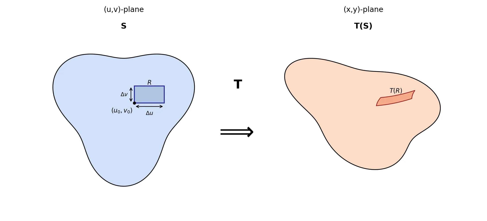

## Motivation: The geometry of area scaling {#sec-motivation}

We want to compute an integral over a region $D$ in the $xy$-plane that is difficult to integrate over directly:  
$$
\iint_D f(x,y)  dx  dy.
$$  
Suppose we have a smooth change of variables $T$ mapping a simpler region $S$ in the $uv$-plane to $D$:  
$$
T(u,v) = \bigl( x(u,v),  y(u,v) \bigr), \quad D = T(S).
$$  
**Substituting $f$ is straightforward:**  
$$
f(x,y) \quad \text{becomes} \quad f\bigl( x(u,v), y(u,v) \bigr).
$$  
But **what happens to the area element $dx  dy$?** This is the heart of the matter.  

### **How integrals are built (recalling the foundation)**  
Double integrals are defined as limits of Riemann sums. We:  
1. Partition $D$ into tiny rectangles $R_i$ with area $\approx \Delta x_i \Delta y_i$,  
2. Sample $f$ at points $(x_i,y_i) \in R_i$,  
3. Sum: $\sum f(x_i,y_i) \cdot (\Delta x_i \Delta y_i)$,  
4. Take the limit as rectangles shrink: $\iint_D f  dx  dy = \lim_{\max|R_i|\to 0} \sum f(x_i,y_i) \Delta x_i \Delta y_i$.  

### **The transformation warps area**  
Under $T$, our partition of $S$ (in $uv$-coordinates) maps to a partition of $D$:  

- A tiny rectangle $R = [u_0, u_0+\Delta u] \times [v_0, v_0+\Delta v]$ in $S$ (area $= \Delta u  \Delta v$),  
- Maps to a *curved patch* $T(R)$ in $D$ (area $\neq \Delta u  \Delta v$). See the figure:

:::{.callout-caution}
**Critical observation:**  
*$dx  dy$ is **not** simply $du  dv$. The transformation $T$ distorts area.*  
:::

**Question:** How can we compute  the $\text{Area}(T(R))$? 
 
To answer this, we first set up the spaces and assumptions.

---

## **The setting: Spaces, transformations, and assumptions** {#sec-setting}

- **Domain:** $U \subset \mathbb{R}^2$ (open set) with coordinates $(u,v)$.  
- **Transformation:** $T: U \to \mathbb{R}^2$ defined by $T(u,v) = (x(u,v),  y(u,v))$.  
- **Smoothness:** $T$ is $C^1$ (continuously differentiable), i.e., $\partial x/\partial u$, $\partial x/\partial v$, $\partial y/\partial u$, $\partial y/\partial v$ exist and are continuous on $U$.  
- **Image:** For any set $S \subset U$, $T(S) = \{ T(u,v) \mid (u,v) \in S \} \subset \mathbb{R}^2$. 

---

## **Local Linearization and the Jacobian Matrix** {#sec-local-linearization}

To understand how the transformation $T$ distorts area, we leverage its most important property "**differentiability**". Because $T$ is $C^1$, it can be closely approximated by a linear map near any point. 

### **The Jacobian Matrix** {#jacobian-matrix}

For a differentiable map $T(u, v) = (x(u, v), y(u, v))$, the **Jacobian matrix** at $(u_0, v_0)$ is the matrix of its partial derivatives:

$$
DT(u_0, v_0) =
\begin{pmatrix}
\frac{\partial x}{\partial u} & \frac{\partial x}{\partial v} \\[6pt]
\frac{\partial y}{\partial u} & \frac{\partial y}{\partial v}
\end{pmatrix}_{(u_0,v_0)}
$$

This matrix, $DT$, is the linear-algebraic representation of the derivative of $T$. Its columns are the vectors $\mathbf{T}_u = (\partial x/\partial u, \partial y/\partial u)^\top$ and $\mathbf{T}_v = (\partial x/\partial v, \partial y/\partial v)^\top$.

### **The Local Linear Approximation** {#linear-approximation}

The differentiability of $T$ means that near a point $(u_0, v_0)$, the function is well-approximated by its linear part. Formally, for a small displacement $(\Delta u, \Delta v)$, we have:

$$
T(u_0 + \Delta u, v_0 + \Delta v) = T(u_0, v_0) + DT(u_0, v_0) \begin{pmatrix} \Delta u \\[2pt] \Delta v \end{pmatrix} + \mathbf{r}(\Delta u, \Delta v)
$$

Here, $\mathbf{r}(\Delta u, \Delta v) = (r_1, r_2)$ is a **remainder vector** that captures the error of this linear approximation.

### **The Key Property: Quantifying the Error** {#error-quantification}

The entire theory rests on how small the remainder $\mathbf{r}$ is. The differentiability of $T$ guarantees that $\mathbf{r}$ vanishes faster than the linear displacement itself. We can express this idea in two equivalent ways, which will lead to our two different proofs.

#### **Viewpoint A: The "Little-o" Notation** {#viewpoint-a}

This notation captures the intuition perfectly. We write:

$$
|\mathbf{r}(\Delta u, \Delta v)| = o\left(\sqrt{(\Delta u)^2 + (\Delta v)^2}\right) \quad \text{as } (\Delta u, \Delta v) \to (0,0)
$$

The notation $f =o(g(x))$ as $x \to a$ means the function $f$ is *much smaller* than $g$ as $x \to a$. More formally:

$$
\lim_{x \to a} \frac{f(x)}{g(x)} = 0.
$$

In our case:

$$
\lim_{(\Delta u, \Delta v) \to (0,0)} \frac{|\mathbf{r}(\Delta u, \Delta v)|}{\sqrt{(\Delta u)^2 + (\Delta v)^2}} = 0
$$

#### **Viewpoint B: The "Epsilon-Delta" Definition** {#viewpoint-b}

This viewpoint makes the error bound explicit. For any chosen tolerance $\varepsilon > 0$, there exists a neighborhood around $(u_0, v_0)$ such that:

$$
|\mathbf{r}(\Delta u, \Delta v)| < \varepsilon \sqrt{(\Delta u)^2 + (\Delta v)^2}
$$

whenever $\sqrt{(\Delta u)^2 + (\Delta v)^2}$ is sufficiently small.

**Interpretation:** We can force the error to be as small as we want relative to the displacement by restricting our view to a small enough region.

 
These two viewpoints are logically equivalent. Viewpoint A is more concise and intuitive, while Viewpoint B is more explicit and constructive. In the following sections, we will use this local linearization to find the area of $T(R)$.

---

## **Image of a small rectangle: Edge vectors** {#sec-edge-vectors}

The edges of $R$ emanating from $(u_0, v_0)$ map to vectors in $\mathbb{R}^2$:  

$$
\begin{aligned}
\mathbf{a} &= T(u_0 + \Delta u, v_0) - T(u_0, v_0) = \underbrace{\begin{pmatrix} x_u \\ y_u \end{pmatrix}_{(u_0,v_0)} \Delta u}_{\mathbf{T}_u  \Delta u} + \mathbf{r}_1, \\
\mathbf{b} &= T(u_0, v_0 + \Delta v) - T(u_0, v_0) = \underbrace{\begin{pmatrix} x_v \\ y_v \end{pmatrix}_{(u_0,v_0)} \Delta v}_{\mathbf{T}_v  \Delta v} + \mathbf{r}_2,
\end{aligned}
$$  

where:  
- $\mathbf{T}_u = (\partial x/\partial u,  \partial y/\partial u)^\top$ and $\mathbf{T}_v = (\partial x/\partial v,  \partial y/\partial v)^\top$ are the **column vectors of $DT$**,  
- $\mathbf{r}_1 = \mathbf{r}(\Delta u, 0)$ and $\mathbf{r}_2 = \mathbf{r}(0, \Delta v)$ are remainder vectors satisfying:  
  $$
  \lim_{\Delta u \to 0} \frac{\|\mathbf{r}_1\|}{|\Delta u|} = 0, \quad \lim_{\Delta v \to 0} \frac{\|\mathbf{r}_2\|}{|\Delta v|} = 0.
  $$

:::{.column-body-outset}
<iframe src="LocalLinearizationDemo.html" width="100%" height="800px" style="border:none;"></iframe>
:::

::: {.callout-tip .column-body-outset}

**Interactive Figure: Local Linearization in Action ([click to open in a new tab](LocalLinearizationDemo.html){target="_blank" rel="noopener"})**

- *Drag the handles or adjust the parameters ($u_0$, $v_0$, $\Delta u$, $\Delta v$) to see how the transformation $T$ distorts the rectangle $R$.*

- Observe how $T(R)$ **approaches a parallelogram** as $\Delta u, \Delta v \to 0$ — note that “approaches 0” means *gets smaller*, not *equals 0*.

- See the edge vectors $\mathbf{a} = T(u_0+\Delta u,v_0) - T(u_0,v_0)$ and $\mathbf{b} = T(u_0,v_0+\Delta v) - T(u_0,v_0)$

:::
---

## **Area of the linear approximation** {#sec-linear-approximation-area}

Ignoring remainders ($\mathbf{r}_1 = \mathbf{r}_2 = \mathbf{0}$), $T(R)$ approximates a parallelogram spanned by $\mathbf{T}_u \Delta u$ and $\mathbf{T}_v \Delta v$.

Using the fact that the **determinant of a** $(2 \times 2)$ **matrix is the signed area** of the parallelogram formed by its column vectors (and its absolute value gives the actual area), we obtain:

$$
\det \begin{bmatrix} \mathbf{T}_u \Delta u & \mathbf{T}_v \Delta v \end{bmatrix} = \det \left( DT(u_0,v_0) \begin{pmatrix} \Delta u & 0 \\ 0 & \Delta v \end{pmatrix} \right) = \det(DT(u_0,v_0)) \cdot \Delta u  \Delta v.
$$  

**Crucially, this linear approximation becomes exact in the limit** because differentiability (@sec-local-linearization) forces the remainder vectors $\mathbf{r}_1, \mathbf{r}_2 \to \mathbf{0}$ faster than $\Delta u, \Delta v \to 0$. We now quantify this rigorously.

---

## **Rigorous error analysis for area approximation** {#sec-error-analysis}

The determinant of the edge vectors $\mathbf{a}$ and $\mathbf{b}$ gives the exact signed area of the parallelogram they span. We use this parallelogram to approximate the image $T(R)$ locally (@sec-edge-vectors):  

$$
\det \begin{bmatrix} \mathbf{a} & \mathbf{b} \end{bmatrix} = \det \begin{bmatrix} \mathbf{T}_u \Delta u + \mathbf{r}_1 & \mathbf{T}_v \Delta v + \mathbf{r}_2 \end{bmatrix}.
$$  

By bilinearity of the determinant:  

$$
\begin{aligned}
\det \begin{bmatrix} \mathbf{a} & \mathbf{b} \end{bmatrix} &= \det \begin{bmatrix} \mathbf{T}_u \Delta u & \mathbf{T}_v \Delta v \end{bmatrix} + \det \begin{bmatrix} \mathbf{r}_1 & \mathbf{T}_v \Delta v \end{bmatrix} + \det \begin{bmatrix} \mathbf{T}_u \Delta u & \mathbf{r}_2 \end{bmatrix} + \det \begin{bmatrix} \mathbf{r}_1 & \mathbf{r}_2 \end{bmatrix} \\
&= \det(DT) \cdot \Delta u  \Delta v + E(\Delta u, \Delta v),
\end{aligned}
$$  

where the **error term** $E$ is:  

$$
E = \det \begin{bmatrix} \mathbf{r}_1 & \mathbf{T}_v \Delta v \end{bmatrix} + \det \begin{bmatrix} \mathbf{T}_u \Delta u & \mathbf{r}_2 \end{bmatrix} + \det \begin{bmatrix} \mathbf{r}_1 & \mathbf{r}_2 \end{bmatrix}.
$$  

Before analyzing why $E$ is negligible relative to $\Delta u \Delta v$, recall:
$$
\det[\mathbf p\ \mathbf q]=|\mathbf p||\mathbf q|\sin\theta
$$
Therefore, the area of the parallelogram is at most the product of its side lengths:
$$
|\det[\mathbf p\ \mathbf q]| \le |\mathbf p||\mathbf q|
$$

Geometrically, $|\det[\mathbf p\ \mathbf q]|$ is exactly the area of the parallelogram spanned by $(\mathbf p)$ and $(\mathbf q)$, so it cannot exceed the product of their lengths.

::::: {.panel-tabset}
### **Proof using Little-o Notation**

**By differentiability (@sec-local-linearization):**  
- $\mathbf{r}(\Delta u, \Delta v) = o\left(\sqrt{(\Delta u)^2 + (\Delta v)^2}\right)$ as $(\Delta u, \Delta v) \to (0,0)$.  
- For the edge remainders (@sec-edge-vectors), this implies:  
  $$
  \|\mathbf{r}_1\| = \|\mathbf{r}(\Delta u, 0)\| = o(|\Delta u|), \quad \|\mathbf{r}_2\| = \|\mathbf{r}(0, \Delta v)\| = o(|\Delta v|).
  $$  
**By $C^1$ continuity:** The partial derivatives are bounded near $(u_0,v_0)$. Let $M > 0$ satisfy:  
$$
\|\mathbf{T}_u\| \leq M, \quad \|\mathbf{T}_v\| \leq M \quad \text{(in a neighborhood of $(u_0,v_0)$)}.
$$  

Using $\left| \det \begin{bmatrix} \mathbf{p} & \mathbf{q} \end{bmatrix} \right| \leq \|\mathbf{p}\| \|\mathbf{q}\|$:  
1. **First error term:**  
   $$
   \left| \det \begin{bmatrix} \mathbf{r}_1 & \mathbf{T}_v \Delta v \end{bmatrix} \right| \leq \|\mathbf{r}_1\| \cdot \|\mathbf{T}_v \Delta v\| \leq \underbrace{o(|\Delta u|)}_{\mathbf{r}_1} \cdot \underbrace{M |\Delta v|}_{\mathbf{T}_v \Delta v} = o(|\Delta u \Delta v|).
   $$  
2. **Second error term:**  
   $$
   \left| \det \begin{bmatrix} \mathbf{T}_u \Delta u & \mathbf{r}_2 \end{bmatrix} \right| \leq \|\mathbf{T}_u \Delta u\| \cdot \|\mathbf{r}_2\| \leq \underbrace{M |\Delta u|}_{\mathbf{T}_u \Delta u} \cdot \underbrace{o(|\Delta v|)}_{\mathbf{r}_2} = o(|\Delta u \Delta v|).
   $$  
3. **Third error term:**  
   $$
   \left| \det \begin{bmatrix} \mathbf{r}_1 & \mathbf{r}_2 \end{bmatrix} \right| \leq \|\mathbf{r}_1\| \|\mathbf{r}_2\| = \underbrace{o(|\Delta u|)}_{\mathbf{r}_1} \cdot \underbrace{o(|\Delta v|)}_{\mathbf{r}_2} = o(|\Delta u \Delta v|).
   $$  

**Summing these:**  
$$
|E| \leq o(|\Delta u \Delta v|) + o(|\Delta u \Delta v|) + o(|\Delta u \Delta v|) = o(|\Delta u \Delta v|).
$$  
Thus,  
$$
\lim_{(\Delta u, \Delta v) \to (0,0)} \frac{E}{\Delta u  \Delta v} = 0.
$$  

**Conclusion:** The signed area is  
$$
\det \begin{bmatrix} \mathbf{a} & \mathbf{b} \end{bmatrix} = \det(DT(u_0,v_0)) \cdot \Delta u  \Delta v + o(\Delta u \Delta v).
$$  
For **actual area**, we take absolute values (noting $o(\Delta u \Delta v)$ absorbs sign changes):  
$$
\boxed{\text{Area}(T(R)) = \left| \det(DT(u_0,v_0)) \right| \Delta u  \Delta v + o(\Delta u \Delta v)}
$$  

### **Proof using Epsilon-Delta Bounds**

**Error bound**  
Using $\left| \det \begin{bmatrix} \mathbf{p} & \mathbf{q} \end{bmatrix} \right| \leq \|\mathbf{p}\| \|\mathbf{q}\|$ (equality iff $\mathbf{p} \perp \mathbf{q}$):  
- Let $M = \max \left\{ \|\mathbf{T}_u\|, \|\mathbf{T}_v\| \right\}$ (finite since $T$ is $C^1$).  
- For any $\varepsilon > 0$, $\exists \delta > 0$ such that $\|\mathbf{r}_1\| < \varepsilon |\Delta u|$ and $\|\mathbf{r}_2\| < \varepsilon |\Delta v|$ whenever $\max(|\Delta u|, |\Delta v|) < \delta$.  
Then:  
$$
\begin{aligned}
|E| &\leq |\Delta v| \cdot \|\mathbf{r}_1\| \|\mathbf{T}_v\| + |\Delta u| \cdot \|\mathbf{T}_u\| \|\mathbf{r}_2\| + \|\mathbf{r}_1\| \|\mathbf{r}_2\| \\
&< |\Delta u| |\Delta v| \left( M \varepsilon + M \varepsilon + \varepsilon^2 \right) \\
&= |\Delta u| |\Delta v| \left( 2M \varepsilon + \varepsilon^2 \right).
\end{aligned}
$$  
Thus:  
$$
\frac{|E|}{|\Delta u  \Delta v|} < 2M \varepsilon + \varepsilon^2 \xrightarrow[\delta \to 0]{} 0.
$$  
**Conclusion:** The signed area is $\det(DT) \Delta u \Delta v + o(\Delta u \Delta v)$. For **actual area**, we take absolute values:  
$$
\text{Area}(T(R)) = \left| \det(DT(u_0,v_0)) \right| \Delta u  \Delta v + o(\Delta u \Delta v).
$$

:::::

:::{.callout-note}
**Remark: from the parallelogram to $T(R)$.** As $\Delta u, \Delta v \to 0$, the parallelogram approximates the actual image $T(R)$ increasingly well. In particular, every point of $T(R)$ lies within $o(\max(\Delta u, \Delta v))$ of the parallelogram (by differentiability), and inflating a parallelogram by such a distance changes its area by only $o(\Delta u \Delta v)$. Their area difference is therefore $o(\Delta u \Delta v)$, so the same limiting area approximation holds for $T(R)$.
:::

---

## **From local to global: The change of variables formula** {#sec-global-formula}

Partition $S \subset U$ into small rectangles $R_{ij}$. By our local analysis (@sec-error-analysis), the area of $T(R_{ij})$ is $\left| \det(DT(u_i,v_j)) \right| \Delta u  \Delta v + o(\Delta u \Delta v)$. Summing over all rectangles and taking the limit as the partition refines:  

$$
\text{Area}(T(S)) = \lim_{\max \Delta u, \Delta v \to 0} \sum_{i,j} \text{Area}(T(R_{ij})) = \iint_S \left| \det(DT(u,v)) \right|  du  dv.
$$  

For a continuous function $f$, the same partitioning argument gives:  

$$
\boxed{
\iint_{T(S)} f(x,y)  dx  dy = \iint_S f(T(u,v)) \left| \det(DT(u,v)) \right|  du  dv
}
$$  

---

## **Essential Conditions for Validity** {#sec-essential-conditions}

The change of variables formula requires two conditions to ensure the Jacobian accurately captures local area scaling:

### **1. Injectivity** {#injectivity}
$T$ must be **one-to-one** on $S$: distinct points in $S$ map to distinct points in $T(S)$.  
- **Why?** Non-injective maps *fold* the domain, causing overcounting in integrals.  
- **Workaround:** Partition $S$ into regions where $T$ *is* injective and apply the formula piecewise.

### **2. Non-Singular Jacobian** {#non-singular}
$\det(DT) \neq 0$ **almost everywhere** on $S$ (i.e., except on sets of **measure zero**). 

:::{.callout-note}

A set $S \subset \mathbb{R}^n$ has **measure zero** if:

For every $\varepsilon > 0$ you can cover $S$ with **countably many** rectangles (or balls) whose total volume is less than $\varepsilon$. 

*(Examples: isolated points, smooth curves in $\mathbb{R}^2$.)*  

:::

- **Why?** Where $\det(DT) = 0$ on a set of *positive measure*, $T$ collapses regions to lower dimensions (e.g., surfaces to curves), breaking area scaling.  
- **Key point**: Sets of measure zero do not affect integrals, so vanishing Jacobians there are harmless.

### **Formula Validity** {#key-takeaway}
The formula  
$$
\iint_{T(S)} f(x,y)  dx  dy
= \iint_S f(T(u,v))  \big|\det(DT(u,v))\big|  du  dv
$$  
holds when:  
1. $T$ is **injective** on $S$,  
2. $T$ is **$C^1$** (continuously differentiable), and  
3. $\det(DT) \neq 0$ **almost everywhere** on $S$.  

---

## **Examples** {#sec-examples}

1. **Uniform scaling:** $T(u,v) = (2u, v)$.  
   $$
   DT = \begin{pmatrix} 2 & 0 \\ 0 & 1 \end{pmatrix}, \quad \det(DT) = 2 \implies dx  dy = |2|  du  dv = 2  du  dv.
   $$  
   *Interpretation:* Areas double under $T$.  

2. **Polar coordinates:** $T(r,\theta) = (r\cos\theta, r\sin\theta)$ for $r > 0$.  
   $$
   DT = \begin{pmatrix} \cos\theta & -r\sin\theta \\ \sin\theta & r\cos\theta \end{pmatrix}, \quad \det(DT) = r(\cos^2\theta + \sin^2\theta) = r.
   $$  
   Thus $dx  dy = |r|  dr  d\theta = r  dr  d\theta$ (since $r > 0$).  
   *Interpretation:* The factor $r$ accounts for increasing "width" of angular sectors at larger radius.

---

## **Final summary and extension to higher dimensions** {#sec-summary-extension}

For a $C^1$ transformation $T: (u,v) \mapsto (x,y)$ with almost non-singular Jacobian ($\det(DT) \neq 0$) on $S$:  

$$
\boxed{ dx  dy = \left| \det \begin{pmatrix} \partial x/\partial u & \partial x/\partial v \\ \partial y/\partial u & \partial y/\partial v \end{pmatrix} \right| du  dv }
$$  

**This is the foundation of the change of variables formula.** The absolute value of the Jacobian determinant universally quantifies how $T$ distorts infinitesimal areas. Rigorous justification requires $C^1$ smoothness to control linearization errors, as shown in @sec-error-analysis.

---  

**Crucially, this entire framework scales seamlessly to higher dimensions.** For a $C^1$ transformation $T: \mathbb{R}^n \to \mathbb{R}^n$ defined by $T(u_1, \dots, u_n) = (x_1, \dots, x_n)$, the Jacobian matrix $DT$ becomes an $n \times n$ matrix of partial derivatives:  

$$
DT = \begin{pmatrix}
\frac{\partial x_1}{\partial u_1} & \cdots & \frac{\partial x_1}{\partial u_n} \\
\vdots & \ddots & \vdots \\
\frac{\partial x_n}{\partial u_1} & \cdots & \frac{\partial x_n}{\partial u_n}
\end{pmatrix}.
$$  

The **absolute value of its determinant**, $|\det(DT)|$, serves as the *local volume scaling factor* for infinitesimal $n$-dimensional cubes. This is because:  
1. **Linear approximation:** Near any point, $T$ is approximated by the linear map $DT$.  
2. **Volume scaling:** The determinant $\det(DT)$ gives the signed volume of the parallelepiped spanned by the column vectors of $DT$ (the images of the unit coordinate vectors).  
3. **Error control:** Differentiability ensures nonlinear errors vanish faster than the volume element $du_1 \cdots du_n$ as the partition refines, exactly as in the $\mathbb{R}^2$ case (@sec-error-analysis).  

Consequently, the change of variables formula generalizes to:  

$$
\int_{T(S)} f(\mathbf{x})  d\mathbf{x} = \int_S f(T(\mathbf{u})) \left| \det(DT(\mathbf{u})) \right|  d\mathbf{u},
$$  

where $d\mathbf{x} = dx_1 \cdots dx_n$ and $d\mathbf{u} = du_1 \cdots du_n$. Whether computing volumes in $\mathbb{R}^3$ (where $|\det(DT)|$ scales infinitesimal cubes), probability densities in statistics, or flux integrals in physics, **the Jacobian determinant remains the universal scaling factor for volume elements under smooth coordinate transformations in any dimension.**

